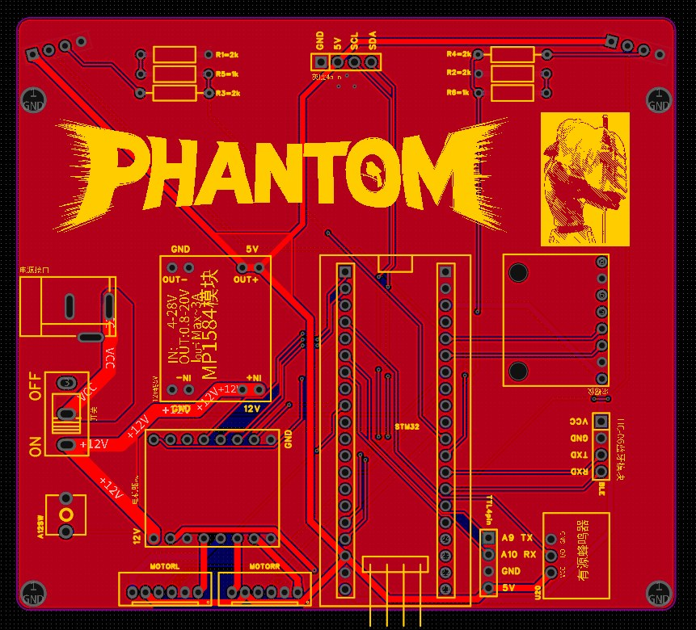

<h1 align="center">Phantom Drive</h1>

<p align="center"><b>重走古丝路 · 自动循迹避障小车</b><br>
三轮差速小车 · 全自动循迹 + 动态避障 + 终点精停</p>

<p align="center">
  
</p>

<p align="center">
  <a href="README.md"><b>中文</b></a> ｜ <a href="README.en.md">English</a>
</p>

<p align="center">
  
  
  
  
</p>

---

## 这是什么

一台**从零自制**的三轮小车：STM32F103C8T6 + 自制 PCB + 8 路灰度 + 双超声波，能沿黑线全自动跑完 6.2m × 2m 赛道、绕开随机摆位的障碍物、并在终点自动判停。

2026 年华南理工大学《工程创新训练》课程项目，**比赛获二等奖**。

## 亮点

| | |
|---|---|
| **循迹** | 8 路灰度 → 位置误差 + PID + 舵量斜坡；按曲率风险（误差 / 边缘通道 / 陀螺偏航率）自动降速 |
| **避障** | 双 HC-SR04：400mm 预减速、310mm 接管；固定两段轨迹绕行，见线即退 |
| **回线** | 过线全白 → 最大制动 → 原地旋转 → 线居中 → 保持 → 交还循迹（先进慢速窗口） |
| **脱线兜底** | 循迹中意外丢线：判方向 → 停车 → 原地旋转找回 → 居中交回；T 头/黑条一律否决 |
| **终点** | 30s 时间闸 + 八路扫过 + 全白 ⇒ 冲刺 100ms@70% ⇒ 刹停 + 双长鸣 + 存快照 |

## 硬件

STM32F103C8T6（64MHz，HSI）· 感为八路灰度（I2C1）· HC-SR04 ×2 · MPU6050（I2C2）· TB6612FNG · JGB37-520 减速电机 ×2 + 万向轮 · 单 12V 锂电池 · 自制 PCB v2.1（嘉立创 EDA）+ 激光切割 + 3D 打印车架。

## 快速开始

```bash
git clone https://github.com/Freebird415/phantom-drive.git
cd phantom-drive

pio run -d firmware                  # 编译
pio run -d firmware -t upload        # 烧录（ST-Link）
python tools/flash.py                # 一键：编译 + 多策略重试 + 中文诊断
python tools/btview.py               # 无线日志网页界面（跑车时看数据）
```

参数集中在 **唯一出处** [`firmware/src/app/tuning.h`](firmware/src/app/tuning.h)。

## 仓库结构

| 目录 | 内容 |
|---|---|
| [`firmware/`](firmware/) | 固件（platformio 工程）· 驱动接口说明 · 逐版算法归档 |
| [`hardware/`](hardware/) | 嘉立创 EDA 工程 · 电气设计（网表 + 接线图 + 自检脚本）· BOM |
| [`mech/`](mech/) | 结构设计与加工证据（STEP / STL / DXF / 实物照） |
| [`tools/`](tools/) | 上位机：无线日志、遥测解析、板载快照读取、轨迹重建、烧录 |
| [`docs/`](docs/) | 技术约定 · 遥测协议 · 引脚分配表 |
| [`项目记录/`](项目记录/) | 开发记录 · 踩坑记录 · 决策台账 · 版本索引 · 比赛日操作卡 |
| [`logs/`](logs/) | 跑车记录摘要（每次实验一份 3~6KB 的 md） |
| [`参考资料/`](参考资料/) | 比赛规则原文 · 器件手册 · 实物照 |

## 技术要点

- **分层**：`app → drv → bsp` 单向依赖；一个器件一个 `drv_*` 文件
- **可观测**：`$T` 100Hz 遥测（灰度/误差/PWM/状态）+ `$E` 事件码 + 板载快照（RAM 1200 帧，停车写 Flash，掉电不丢）+ 无线 BLE 实时日志
- **安全**：发车开关默认关（`TRACE 0` / `AVOID 0` = 只算不发）；灰度离线时绝不驱动电机；固件体积由 `check_size.py` 编译期把关（<54KB）
- **参数单一出处**：`tuning.h` 集中全部可调数值，其余代码只引用

## 成员

李沛阳（组长：仓库与协作规范、反馈链路与工具链、底层驱动与框架）· 王政淋（选型采购、电路与电气集成）· 熊雅琦（A01 循迹）· 李昕程（结构设计与加工）· 毕烨恺（A02 避障与回线、展示材料）

## 引用

本项目为华南理工大学《工程创新训练》课程作业，转载或引用请注明来源。
